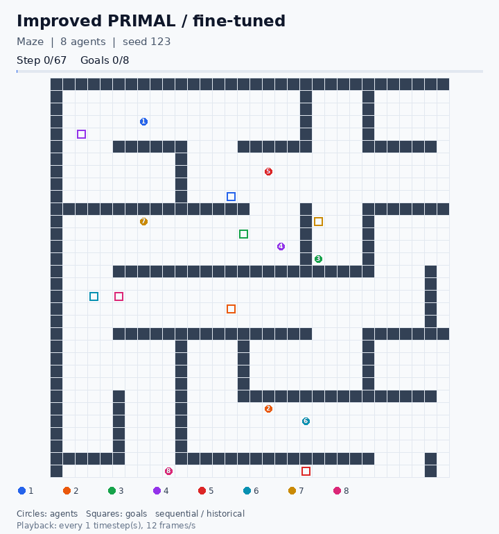
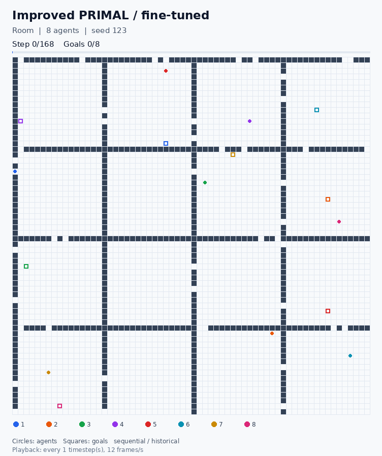
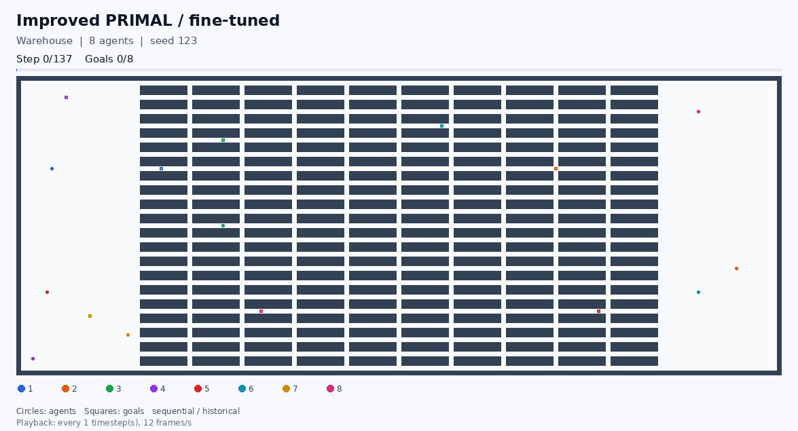

# PRIMAL MAPF

Training and evaluation of neural policies for multi-agent path finding (MAPF).
Each agent has to reach its own goal on a grid without hitting obstacles or
colliding with other agents.

The project compares a classic PRIMAL-style PyTorch network with a variant
using residual blocks and attention-based communication. It also includes
PIBT, Cooperative A* (CA*), and Conflict-Based Search (CBS) as planning baselines.

## Fine-tuned models in action

The improved model with map-specific fine-tuned weights, eight agents, and seed
123. These runs use sequential movement and historical observation settings.
Each agent reaches its own goal; colors match agents to goals.

### Maze — 67 timesteps



### Rooms — 168 timesteps



### Warehouse — 137 timesteps



[Videos, exact trajectories, checkpoint hashes, and reproduction commands](docs/animations/README.md).
These are completed example rollouts, not aggregate benchmark results. The
corresponding four-agent runs also completed; all six attempts are recorded.

## Models

Both networks use local grid observations, a goal vector, and an LSTM state.
The `improved` variant adds residual convolutional blocks and attention over
nearby agents' hidden states. Training combines actor-critic reinforcement
learning with optional imitation of solver-generated plans.

By default, both models use the same reward and observation settings and move
in simultaneous timesteps. Historical environment profiles and sequential
execution are also available. See [architecture](docs/ARCHITECTURE.md) for details.

## Installation

Python 3.11 or newer is required. The command-line tools currently run on CPU.
From the repository root:

```bash
python3 -m venv .venv
source .venv/bin/activate
python -m pip install torch --index-url https://download.pytorch.org/whl/cpu
python -m pip install -e .
```

For the pinned Linux x86_64 / Python 3.12 environment, install
[requirements-lock-linux-cpu.txt](requirements-lock-linux-cpu.txt) before
installing the project. Platform details are listed in
[validation notes](docs/VALIDATION.md).

## Quick start

```bash
python scripts/smoke.py
```

This trains both models for two short episodes, evaluates their checkpoints
alongside PIBT, and writes an SVG to `results/quickstart/trajectory.svg`.
No pretrained weights or C++ libraries are needed. The short episode limits
make this an installation check rather than a useful training run.

Use a new directory when repeating it:

```bash
python scripts/smoke.py --output results/quickstart_repeat
```

## Training

Start either model with random weights:

```bash
python scripts/train.py --config configs/train_classic.json
python scripts/train.py --config configs/train_improved.json
```

To start from existing base weights:

```bash
python scripts/train.py --config configs/train_classic_finetune.json --init checkpoints/base/classic.pt
python scripts/train.py --config configs/train_improved_finetune.json --init checkpoints/base/improved.pt
```

The base weights must be supplied separately; they are not included in Git.
`--init` loads model parameters and starts a new optimizer and episode counter.

| Run | Output directory |
| --- | --- |
| Classic, from scratch | `results/train_classic/` |
| Improved, from scratch | `results/train_improved/` |
| Classic, initialized from weights | `results/finetune_classic/` |
| Improved, initialized from weights | `results/finetune_improved/` |

Edit the JSON configurations to set the episode count, number of agents, map
size, obstacle density, rollout length, and optimizer parameters. `episodes`
is the total target count. Set the same budget for both models when comparing
them. `demonstration_prob` controls how often training uses an expert plan:
`0` selects RL only, `1` selects imitation only. The default expert is PIBT.

To use a fixed map, add a path such as `"map": "maps/maze-32-32-4.map"`.
The defaults `"execution": "joint"` and `"environment_profile": "common"`
apply the same movement, reward, and observation rules to both architectures.

### Checkpoints and resume

Each run writes `checkpoint.pt`, `training.csv`, `config.json`, and
`metadata.json`. New runs require an empty output directory. Files passed
through `--init` are read only; the new checkpoint is saved in the run's
output directory.

`checkpoint.pt` is replaced at each scheduled save and contains the latest
saved state, not the best-performing model. Keep a separate copy of any model
you want to retain before continuing training.

To resume a run, increase `episodes` in its configuration and use:

```bash
python scripts/train.py --config configs/train_classic.json --resume results/train_classic/checkpoint.pt
```

Resume restores the optimizer and episode counter as well as the weights.
Only `episodes`, `output`, and `save_every` may change. Log rows beyond the
restored checkpoint are removed before training continues. On interruption,
the last saved checkpoint remains available.

Resume requires a checkpoint from trainer `primal_joint_masked_v2`. Use
`--init` for older checkpoints. See [model files](checkpoints/README.md).

## Fixed maps

Train or test on `maze`, `room`, and `warehouse` with either model:

```bash
python scripts/fixed_map.py train --map maze --variant classic
python scripts/fixed_map.py train --map maze --variant improved --init base
python scripts/fixed_map.py evaluate --map maze --weights fine-tuned
```

Use `--weights trained` to evaluate new map-specific fine-tuning runs, or
`--weights scratch` for runs trained from random weights. `--variant classic`
or `--variant improved` selects a single model for evaluation. Training outputs
are separated by map, variant, and initialization mode.

See [fixed-map commands](docs/FIXED_MAPS.md) for all checkpoint groups, resume,
custom budgets, and importing the six historical map-specific models. Historical
weights are available locally but excluded from Git.

## Evaluation

All algorithms receive the same maps, starts, and goals. To evaluate the
models created by the quick start:

```bash
python scripts/evaluate.py --config results/quickstart/evaluation_config.json --output results/evaluation_repeat
```

Configurations for varying agent counts, map sizes, densities, and fixed maps
are in `configs/experiments/`. Update their checkpoint paths before running:

```bash
python scripts/evaluate.py --config configs/experiments/agents.json
python scripts/evaluate.py --config configs/experiments/maze.json
```

The supplied experiment configurations reference base weights. For a solver-only
comparison, set `models` to `{}` and select algorithms in `solvers`.
Evaluation requires an empty output directory.

| File | Contents |
| --- | --- |
| `raw.csv` | Success, makespan, elapsed time, and execution mode for each attempt |
| `scenarios.json` | Exact maps, starts, goals, and seeds |
| `summary.json` | Aggregate metrics and Wilson 95% success intervals |
| `summary_by_setting.csv` | Metrics grouped by experimental setting |
| `config.json`, `metadata.json` | Configuration, runtime versions, and source/model hashes |

Makespan counts timesteps. Failed attempts have makespan `-1` and are excluded
from mean makespan. `greedy: true` chooses the most likely legal action;
`false` samples the policy.

In joint mode, following moves and rotations are allowed. Conflicting moves
and edge swaps are cancelled, including moves blocked by those cancellations.
Solver plans and policy trajectories are checked against the same collision
rules. Solver timing includes the Python interface and, for CA*/CBS, process
startup. Policy timing includes environment setup and trajectory validation.

Use `"execution": "sequential"` and `"environment_profile": "historical"`
for the earlier model execution settings. These differ from the default joint
protocol and should be reported separately. Historical weights were trained
under the earlier settings.

## Building CA* and CBS

A C++17 compiler and Python development headers are required. Build with the
same interpreter used to run evaluation:

```bash
python -m pip install -e ".[native]"
python scripts/build_solvers.py
python scripts/evaluate.py --config configs/experiments/solvers_smoke.json
```

Use `--solver ca` or `--solver cbs` to build one library. The resulting extensions
are written to `src/primal_mapf/solvers/` and must be rebuilt after changing
Python interpreters. See [native solvers](native/README.md) for search limits
and interface details.

## Visualization

Create an animation from a fine-tuned model:

```bash
python -m pip install -e ".[visualization]"
python scripts/animate_policy.py --map maze --variant improved --agents 8 --seed 123 --output results/animations/maze
```

Change the map to `room` or `warehouse`, select `--variant classic`, or pass
`--checkpoint PATH` for your own model. GIFs play directly in the README.
Add `--mp4` to export a video with ffmpeg. The output includes the complete
trajectory and model hash. See [animation options](docs/animations/README.md).

For a static SVG after the quick start:

```bash
python scripts/visualize.py --config results/quickstart/evaluation_config.json --variant classic --output results/classic.svg
```

Solver trajectories are also available without weights:

```bash
python scripts/visualize.py --config configs/experiments/solvers_smoke.json --solver pibt --animate --output results/pibt.svg
```

## Experiments

[Research materials](research/README.md) contain the historical measurements,
figures, and experiment scripts. Those results come from the earlier study;
the current trainer uses a different training and evaluation protocol.

A [short training example](docs/portfolio/README.md) includes three training seeds,
shared test scenarios, raw measurements, and runtime metadata. To run it:

```bash
python scripts/portfolio_experiment.py --config configs/portfolio.json
```

Outputs go to `results/portfolio/` and `results/portfolio_report/`. The example
uses eight training episodes per model; it does not establish model convergence.

## Tests

```bash
python -m unittest discover -s tests -v
python scripts/check_docs.py
python scripts/verify_research.py
python scripts/verify_provenance.py
```

Tests requiring base weights or compiled libraries are skipped when those files
are absent. CI runs separate Python and native-library jobs. Linux x86_64 with
Python 3.12 is the locally tested platform; GPU, Windows, and macOS are untested.

## Layout

```text
src/primal_mapf/   Networks, environment, training, evaluation, and solver adapters
native/           CA* and CBS C++ sources
configs/          Training and experiment settings
scripts/          Command-line tools
research/         Historical experiments and measurements
docs/             Architecture, methodology, and example results
checkpoints/      Model metadata and local weight locations
maps/             Moving AI maps
results/          Local run outputs, excluded from Git
tests/            Automated tests
legacy/           Earlier training scripts
third_party/      Licenses and source records
```

Paths inside configurations are relative to the repository root unless absolute.
The `--config` argument is relative to the current directory. For a regular wheel
installation, set `PRIMAL_MAPF_ROOT` to the workspace containing configurations
and maps; otherwise relative paths use the current directory.

## Credits and license

The neural baseline is based on [PRIMAL](https://github.com/gsartoretti/PRIMAL)
by Guillaume Sartoretti and Justin Kerr. The Python PIBT implementation is by
[Keisuke Okumura](https://github.com/Kei18/pypibt). Maps are from Moving AI Lab.

Original project code is distributed under the [MIT license](LICENSE).
CA* and CBS were implemented by Mateusz Ambroży. Third-party terms and source
references are documented in
[THIRD_PARTY_NOTICES.md](THIRD_PARTY_NOTICES.md).
