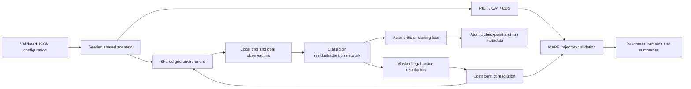

# Architecture and experimental design

## Data flow

## Model variants

Both networks encode four 10 × 10 grid channels and a three-element goal vector,
combine spatial and goal representations, and update a 512-dimensional LSTM
state. Output heads predict action probabilities, state value, blocking, goal
occupancy, and legal actions. The goal-occupancy head is preserved for historical
checkpoint compatibility and has no separate training objective.

The classic variant uses stacked convolutions. The `improved` variant uses
residual convolutional blocks and multi-head attention over previous agent
hidden states. Communication uses a Chebyshev radius of five cells, including
the agent itself. Neighbor hidden states are detached; gradients update the
attention and mixing layers without backpropagating through other agents'
recurrent histories. This communication mask is specified independently of
the even-sized image crop.

Network parameter names are retained so that historical weights can still be
loaded. Named output tuples improve readability without changing state-dict keys.

## Environment and interfaces

`environment.py` contains map state, observation construction, rewards, and both
step APIs. `classic/environment.py` and `improved/environment.py` are thin
compatibility classes selecting historical defaults for direct imports.
Supported training and evaluation explicitly select the `common` profile by
default. This fixes observation and reward rules across architectures.

Historical profiles preserve differences in waiting penalties, blocking
penalties and thresholds, and classic goal-distance capping. Select
`environment_profile: "historical"` to choose a variant-specific historical
profile. New results using the common profile are a new experiment protocol.

`step_joint(actions)` accepts one action per agent, commits a simultaneous
transition, and reports named per-agent rewards and execution status. Conflicting
proposals stay in place; valid following moves and rotations are accepted.
`step((agent_id, action))` retains the sequential project API with one-based
agent identifiers. It is not presented as a Gymnasium `step` method.

`JointMAPFEnv` is the Gymnasium interface. It uses a joint `MultiDiscrete`
action space, a dictionary of stacked grid and goal observations, a summed
scalar reward, and the standard five-element step result. Per-agent rewards
and accepted-action flags are available in `info`. Its own RNG controls reset
sampling, and episode limits are reported as truncation.

## Training and reproducibility

The current trainer is single-process recurrent actor-critic with optional
behavioral cloning. RL samples from a differentiably masked and renormalized
policy; log probabilities and entropy use that same distribution. Auxiliary
losses predict static legal actions and blocking. Cloning replays a validated
expert plan and then learns its actions from stored observations.

Python, NumPy, and PyTorch are seeded for each episode. This makes episode-boundary
resume independent of random draws consumed by earlier episodes in the tested
CPU workflow. The checkpoint includes Adam state and the trainer version;
versions with changed training semantics require initialization with `--init`.
CSV rows beyond the restored checkpoint are removed before resume.

Run metadata records dependency versions, hardware, Git commit context, source
checksums, and evaluation checkpoint hashes. A parent-repository commit is
explicitly labeled as such; the source checksum also identifies uncommitted
project code. Deterministic CPU tests do not imply cross-version or GPU bitwise
reproducibility.

## Comparisons and limitations

Joint trajectories share obstacle, vertex-collision, edge-swap, and goal
constraints. Independent learned action proposals and centralized solver plans
remain different decision procedures. Time measurements are end-to-end for the
implemented interfaces and are not pure neural-network or search-kernel timings.

Per-scenario Wilson intervals describe variation over sampled scenarios for a
fixed policy. Comparing architectures also requires multiple independent training
seeds and matched training budgets. Paired scenarios must not be counted as
independent repetitions across seeds. The included small report demonstrates
this protocol but does not establish converged policy performance.

Historical asynchronous trainers and measurements are retained in `legacy/`
and `research/`. They are evidence from a different workflow; see
[MIGRATION.md](MIGRATION.md) for source mapping.
