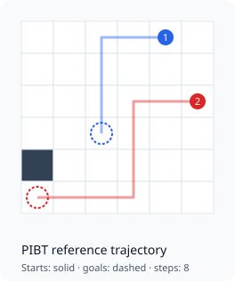

# Short training experiment

Both model variants were trained from random weights with seeds 11, 22, and 33,
then evaluated on the same eight scenarios. Training used eight episodes of
PIBT demonstrations per model. Maps were 6 × 6 with two agents, a requested
obstacle density of 0.05, and a limit of 24 timesteps. Test seeds were 1000–1007.

The full settings are in [experiment.json](experiment.json).

## Results

| Algorithm | Training runs | Success rate, mean ± sample SD across training seeds | Mean successful makespan | Mean elapsed seconds |
| --- | --- | --- | --- | --- |
| classic | 3 | 0.0% ± 0.0 pp | — | 0.1440 |
| improved | 3 | 0.0% ± 0.0 pp | — | 0.2314 |
| pibt | — | 100.0% (one baseline run) | 5.875 | 0.0003 |

Neither learned policy solved a test scenario after this short training run.
PIBT solved all eight. The example is useful for checking the training and
evaluation pipeline; eight episodes are too few to assess the architectures.

Model success rates are averaged over the three training seeds; ± denotes
sample standard deviation in percentage points. PIBT is summarized once because
its repeated runs use the same scenarios. Makespan includes successful attempts
only. Timing depends on hardware and includes environment setup and trajectory
validation for policies.

Per-run summaries contain Wilson 95% success intervals over scenarios. The test
scenarios are shared across training seeds, so repeated measurements should not
be treated as independent trials.



*The trajectory above is computed by PIBT.*

## Run the experiment

From the repository root, choose unused output locations:

```bash
python scripts/portfolio_experiment.py --config configs/portfolio.json --output results/portfolio_repeat --report results/portfolio_report_repeat
```

Each `seed_*` directory contains raw measurements, exact scenarios, summaries,
training logs, and runtime metadata. Configurations in this report use paths
relative to the experiment output directory; make those paths absolute before
running them directly. Checkpoints stay in the local experiment output and are
excluded from this report.
